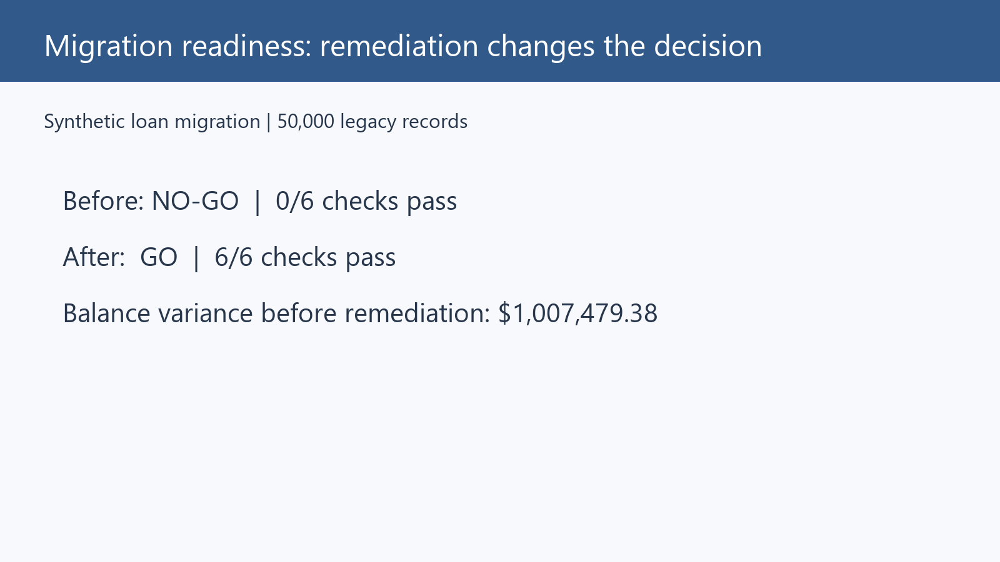
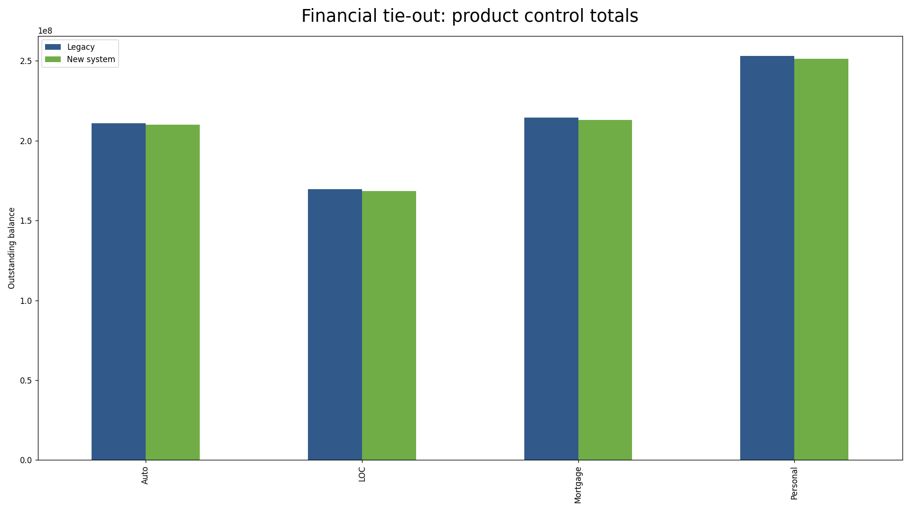
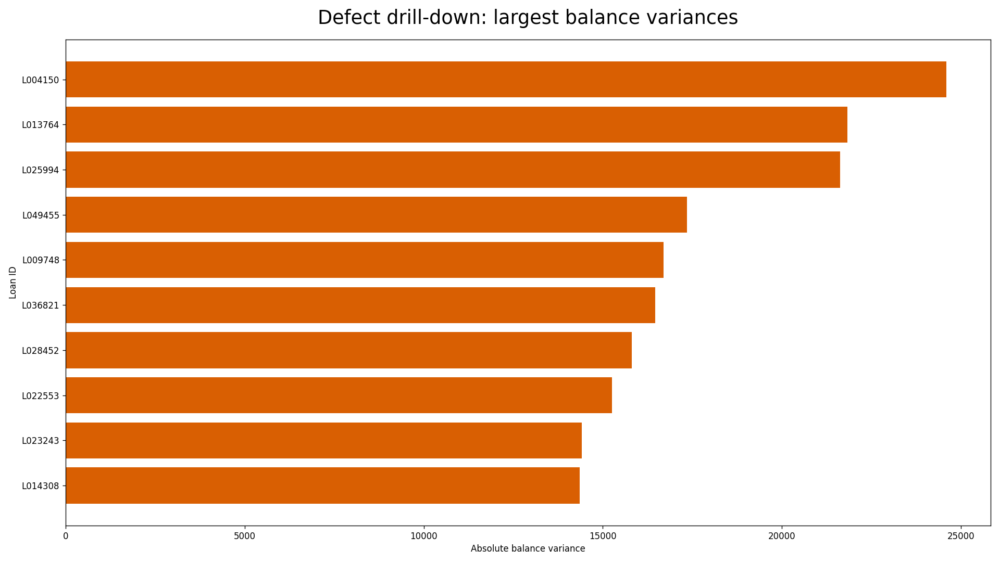

# Migration readiness dashboard

**A reproducible Python + SQL workflow for deciding whether a synthetic loan migration is safe to cut over.**

## The question and the answer

Can leadership trust the migrated data? The pipeline generates a 50,000-loan legacy extract, injects realistic target defects, runs eight reconciliation checks, ranks impact, applies documented remediation, and re-tests. The live answer is always read from `outputs/powerbi_data/scorecard_before_after.csv`; no figures are hard-coded in this README.

The data is synthetic and demonstrates a method, not production results. Power BI build steps and a Streamlit fallback are included because Power BI Desktop cannot be run in this environment.

## Visual walkthrough

The short visual demo shows the readiness summary, financial tie-out, and defect drill-down:


### Readiness summary



### Financial tie-out



### Defect drill-down



Download the [MP4 demo](demo/demo.mp4) for a larger-screen walkthrough.

## Quickstart

```powershell
python -m pip install -r requirements.txt
make all
make test
streamlit run dashboard/app.py
```

`make all` generates the data, runs SQL reconciliation, applies remediation, creates the before/after scorecard, and writes a static chart.

## How it works

```text
synthetic legacy + target extracts
              |
       SQLite named checks
              |
       scorecard + impact ranking
              |
         remediation
              |
          re-test
```

Checks cover row counts, missing loans, orphans, duplicate IDs, balance variance, status mappings, null/date defects, and product-level control totals. Acceptance criteria are documented in `docs/BUSINESS_BRIEF.md`.

## Dashboard and communication artifacts

- `dashboard/app.py` — three-section Streamlit fallback.
- `dashboard/dax_measures.md` and `docs/POWERBI_BUILD_STEPS.md` — Power BI measures and click-by-click build instructions.
- `docs/INSIGHTS_MEMO.md` — stakeholder-facing memo template whose metrics come from generated CSVs.
- `demo/demo_script.md` — timed recording script.
- `presentation/` — reserved for owner-generated PowerPoint/PDF exports.

## Limitations

The records and defects are synthetic, SQLite is used instead of an enterprise database, and the thresholds are illustrative. A production migration would require stakeholder sign-off, audit controls, access controls, performance testing, and checks for defects shared by both systems.

## About

Markus (Wai Ho) Tsui — new-grad data analyst positioning focused on validating, reconciling, quantifying impact, recommending fixes, and proving the fix works. Contact: waiho0311@gmail.com · https://linkedin.com/in/markustsui
